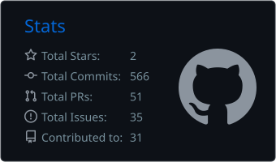
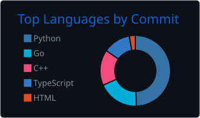
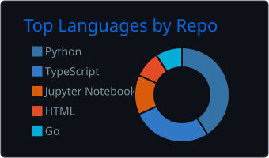
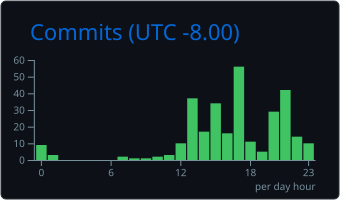

  

  <h3>Archit Shukla</h3>
  
<i>Models are the easy part. I build the plumbing that AI runs on (inference serving, GPU infrastructure, agent backends, agent security) so it stays fast, cheap, safe and reliable in production. I sometimes fix other people's plumbing too.</i>

  
San Francisco, CA

 

M.S. Computer Science, University of Colorado Boulder (GPA 3.9, May 2026).  
I work on LLM inference serving, GPU and distributed systems, the backend and Kubernetes infrastructure AI products run on, and security for AI agents.

**Right now**
- Software Development Intern at **EcoServants**, building backend features on a PHP/MySQL platform for an environmental nonprofit.
- Contributing to open source, with fixes merged into **vLLM**, **LangChain Deep Agents**, **sqlfluff**, **prime-rl** and **Docling**, plus open work in **DSPy**.
- Building **Kith**, a multi-agent platform behind a provider-agnostic inference gateway, and **Kube-Op-Lite**, a Kubernetes operator for GPU workloads.
- Shipped this month: **[Agentwall](https://github.com/Arsh624/agentwall)** (v0.1.1), a local firewall that stops MCP agents from leaking private data, and **[ros2-gpu-pointcloud](https://github.com/Arsh624/ros2-gpu-pointcloud)** (v0.2.0), a ROS 2 point-cloud filter with C++, OpenMP and CUDA backends.

---

## Open Source

Active in six open source repos, with fixes merged into five of them (vLLM, LangChain Deep Agents, sqlfluff, prime-rl and Docling):

- **[vLLM](https://github.com/vllm-project/vllm)** - LLM serving engine. [Report the line of a run-batch request rejected by validators](https://github.com/vllm-project/vllm/pull/65029) (merged), [thinking_token_budget fix](https://github.com/vllm-project/vllm/pull/66056), [keep reasoning-token logprobs out of Responses output_text](https://github.com/vllm-project/vllm/pull/67546)
- **[LangChain Deep Agents](https://github.com/langchain-ai/deepagents)** - Agent harness. [Turn off server log colors so dcode starts on Windows](https://github.com/langchain-ai/deepagents/pull/7591) (merged), [find editor launchers like `code.cmd` on Windows](https://github.com/langchain-ai/deepagents/pull/7642) (merged). Bug report: [CRLF line endings](https://github.com/langchain-ai/deepagents/issues/7488)
- **[sqlfluff](https://github.com/sqlfluff/sqlfluff)** - SQL linter and formatter. [LT01: don't join two words when removing whitespace](https://github.com/sqlfluff/sqlfluff/pull/9008) (merged), [don't respace SparkSQL and Databricks named parameters](https://github.com/sqlfluff/sqlfluff/pull/9030)
- **[prime-rl](https://github.com/PrimeIntellect-ai/prime-rl)** - Agentic RL training at scale. [Skip NUMA binding when the GPU has no sysfs `numa_node`](https://github.com/PrimeIntellect-ai/prime-rl/pull/4202) (merged), [trainer loss logging fix](https://github.com/PrimeIntellect-ai/prime-rl/pull/4352)
- **[Docling](https://github.com/docling-project/docling-core)** - Document processing toolkit. [Keep whitespace-only lines inside a WebVTT cue](https://github.com/docling-project/docling-core/pull/975) (merged), [keep the line break after a span end tag](https://github.com/docling-project/docling-core/pull/1029), [keep whitespace at the edges of cue text](https://github.com/docling-project/docling-core/pull/1030)
- **[DSPy](https://github.com/stanfordnlp/dspy)** - Framework for programming language models. [XMLAdapter list handling fix](https://github.com/stanfordnlp/dspy/pull/10761)

See all of my [pull requests](https://github.com/pulls?q=is%3Apr+author%3AArsh624).

---

## Work

**Software Development Intern, EcoServants** `Aug 2026 – Present`  
Backend features on a PHP/MySQL platform, built with coding agents and gated by mutation testing (13 of 13 injected faults caught across 310+ checks). Proposal autosave with versioned revisions and HMAC-signed unsubscribe tokens.

**Graduate Researcher, Peleg Lab (BioFrontiers Institute)** `Aug 2025 – Jan 2026`  
Distributed AI inference pipelines in Python and multithreaded C++ on GCP GPU clusters. 35% higher evaluation throughput, vLLM on Kubernetes with 300+ sweeps and zero failures, 40% faster fault diagnosis with GDB and Valgrind.

**Software Engineer Intern, Adflix Media** `Apr 2023 – Sep 2023`  
Kafka and Spark ETL landing 5M+ records a day, with Prometheus and Grafana alerting on throughput and consumer lag.

---

## Projects

<table>
<tr>
<td width="50%" valign="top">

**[Agentwall – AI Agent Firewall](https://github.com/Arsh624/agentwall)**

Local firewall between AI agents and their MCP servers. Tracks taint per session to block lethal-trifecta data leaks, keeps API keys in a vault, pins tool definitions, and writes a hash-chained audit log. Blocks 5 of 5 attacks in its suite and adds about 0.2 ms per call at p99.

`Go` `MCP` `JSON-RPC` `GoReleaser`

</td>
<td width="50%" valign="top">

**[ROS 2 GPU Point Cloud](https://github.com/Arsh624/ros2-gpu-pointcloud)**

ROS 2 Jazzy node that range-filters and voxel-downsamples point clouds on CPU, OpenMP or CUDA with identical output. 8.7x faster than single-threaded PCL at 1280x720. Traced a 10 Hz latency tail to GPU idle clocks, and measured Zenoh delivering every 3.7 MB cloud where default Fast DDS dropped 37%.

`C++17` `CUDA` `CUB` `ROS 2` `Docker`

</td>
</tr>
<tr>
<td width="50%" valign="top">

**[Kith – Multi-Agent AI Platform](https://github.com/Arsh624/Kith-Multi-Agent-Relationship-Intelligence-Platform)**

Maps contacts from emails, docs, and meeting notes into a knowledge graph of 1,000+ entities. FastAPI inference gateway over hosted APIs and local vLLM completed 99.2% of agent runs in simulated provider outages.

`LangGraph` `FastAPI` `vLLM` `Neo4j` `Qdrant` `Redis`

</td>
<td width="50%" valign="top">

**[Kube-Op-Lite](https://github.com/Arsh624/kube-op-lite)**

Kubernetes operator in Go that restores failed GPU pods to desired state in under 30 seconds, with admission webhooks, a Helm chart, and benchmark regression analysis.

`Go` `Kubebuilder` `Helm` `Prometheus`

</td>
</tr>
<tr>
<td width="50%" valign="top">

**[RepoGraph V2](https://github.com/Arsh624/Repograph-V2/blob/main/Repograph%20Paper%20.pdf)**

LLM repair for order-dependent flaky tests, guided by a function-state graph and verified across random test orders. With iPFlakies, repair coverage rose from 33% to 56.6% of 537 tests. Written up as a paper.

`Python` `C++` `REST APIs` `Linux`

</td>
<td width="50%" valign="top">

**[Regime-Switching RL for Portfolio Optimization](https://github.com/Arsh624/Regime-switching-RL-model-for-Portfolio-Optimization)**

Three specialist PPO agents routed by an HMM market-regime detector. Sharpe 0.82 to 1.41 and max drawdown 29.6% to 16.2% on 2018–2022 test data.

`PyTorch` `Stable-Baselines3` `Gymnasium`

</td>
</tr>
</table>

## Stack

**Languages** - Python, C++, Go, TypeScript, JavaScript, Java, C, SQL, Bash

**LLM Inference & ML** - vLLM, PyTorch, Speculative Decoding, Continuous Batching, KV Cache, LangGraph, LangChain, DSPy, RAG Pipelines, LLM-as-Judge Evals, Langfuse, PPO / GRPO

**AI Agent Security** - MCP, Taint Tracking, Prompt Injection Defense, Credential Isolation, Tool Pinning, Hash-Chained Audit Logs

**GPU & Robotics** - CUDA, CUB, OpenMP, ROS 2, PCL, Zenoh, Fast DDS

**Backend & Distributed Systems** - FastAPI, Node.js, REST APIs, Microservices, Apache Kafka, Apache Spark, Multithreaded C++, Async & Event-Driven Architectures

**Databases & Data** - PostgreSQL, MySQL, Redis, Neo4j, Qdrant, MongoDB, DynamoDB, ETL Pipelines, Query Optimization

**Cloud & Infrastructure** - Kubernetes, Kubebuilder, Helm, Docker, GCP, AWS, Terraform, CI/CD, GitHub Actions, Linux

**Observability & Debugging** - Prometheus, Grafana, OpenTelemetry, Nsight Systems, GDB, Valgrind, Pytest, Structured Logging

---

## Links

[Portfolio](https://architshukla-portfolio.vercel.app) &nbsp;·&nbsp; [LinkedIn](https://linkedin.com/in/archit-shukla06) &nbsp;·&nbsp; [Email](mailto:architshukla546@gmail.com)

---

